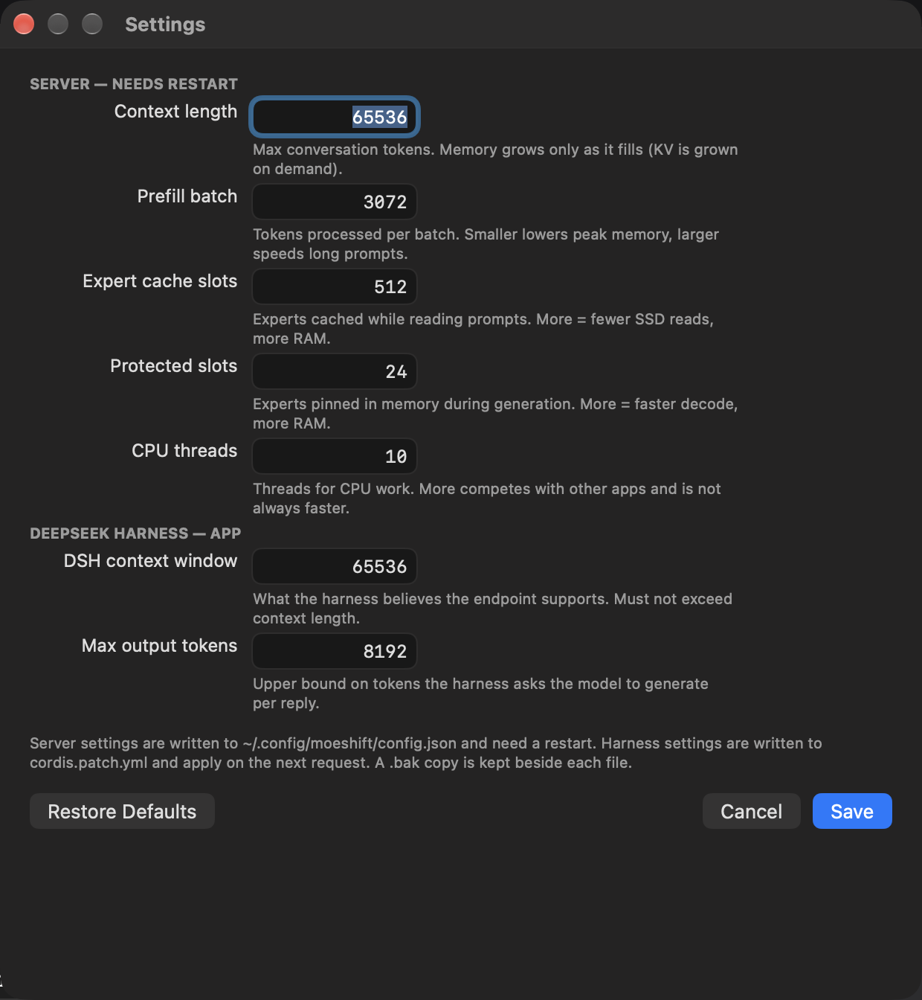

# MoEShift Control Panel

A small macOS app and terminal alternative for running and watching a local
[MoEShift](https://github.com/davide-troiani/moeshift) server on Apple Silicon.

MoEShift streams MoE experts from SSD and runs large models in modest RAM, but it
ships no management surface: it is a CLI process that prints to a terminal, and
its only monitoring endpoint is `/health` (`/metrics`, `/props` and `/slots` return
404). This project adds the missing pieces: start/stop, live progress, and editable
limits.



## What you get

- **Start / Stop** the server, with the app owning the child process so quitting
  never leaves an orphan holding port 8080.
- **Live progress** parsed from the server log: prompt-reading percentage, prompt
  tokens and rate, decoded tokens, and generation tokens/second.
- **Settings** for context length, prefill batch, expert-cache slots, protected
  slots, CPU threads, the harness context window, and the max output tokens.
- **Endpoint checks** for `/health` and `/v1/models`.

## Requirements

- Apple Silicon Mac, macOS 12 or newer.
- A working MoEShift install (`~/.local/bin/moeshift`) and a configuration at
  `~/.config/moeshift/config.json`. See the setup scripts below.
- Xcode **Command Line Tools** only — full Xcode is not required.

## Build and run

```sh
./build.sh
open MoEShift.app
```

`build.sh` compiles `app/*.swift`, writes the bundle, derives the icon from
`docs/icon.png`, and ad-hoc signs the result. Set `OUT=/Applications ./build.sh` to
install elsewhere.

### Terminal alternative

If you prefer no app bundle:

```sh
python3 panel.py
```

Standard library only, Python 3.9+. Keys: `s` start, `x` stop, `g` toggle log
follow, `q` quit (leaves the server running).

## Settings

| Field | Stored in | Effect | Restart? |
|---|---|---|---|
| Context length | `config.json` `args.ctx-size` | Max conversation tokens | yes |
| Prefill batch | `args.prefill-max-tokens` | Prompt speed vs peak RAM | yes |
| Expert cache slots | `args.moe-prefill-bank` | Fewer SSD reads vs more RAM | yes |
| Protected slots | env `LLAMA_MOE_PROTECTED_SLOTS` | Faster decode vs more RAM | yes |
| CPU threads | `args.threads` | CPU throughput | yes |
| DSH context window | `cordis.patch.yml` | What the harness believes | no |
| Max output tokens | `cordis.patch.yml` | Output cap per reply | no |

**Context length is cheaper than it looks.** MoEShift sets `LLAMA_KV_GROW=1`, so the
KV cache starts at ~2048 cells and grows on demand: raising `ctx-size` costs
essentially nothing until a conversation actually fills it. Measured on an M1 Max
(36 GB): 131072 context loaded at 7.5 GB footprint, no higher than 65536.

**The harness window cannot exceed the server context length.** The settings panel
refuses that combination, because the server would reject such a request.

The panel edits `cordis.patch.yml` surgically — it rewrites only the `moeshift`
provider block and leaves comments, ordering and every other provider untouched. A
`.bak` file is written beside both files on every save.

## Setup scripts

`install-homebrew.sh`, `start-moeshift.sh`, `download-model.sh`, `dl-robust.py` and
`finish-setup.sh` reproduce the install used here: build MoEShift from source, fetch
the 125B GGUF shards, extract expert files, and write the server config.

`dl-robust.py` exists because a plain `hf download` failed repeatedly against a
flaky proxy (HuggingFace Xet `CAS Client Error`). It fetches fixed 8 MB ranges,
retries with backoff, checkpoints finished ranges to a `.progress` sidecar, and
refuses to declare success unless every range is accounted for, the size is exact,
and the file looks like a GGUF. Interrupted runs resume instead of restarting.

```sh
export MOESHIFT_SRC="$HOME/src/moeshift"   # your MoEShift checkout
./download-model.sh                        # ~76 GB of GGUF
./finish-setup.sh                          # experts, config, start server
```

## Limitations

- The server handles **one request at a time**; nothing here changes that.
- Progress comes from log parsing, not an API, so an instance started outside the
  app writes elsewhere and the pane stays empty.
- The app stops whatever MoEShift server it can identify, including one started in
  another terminal, so it can take over port 8080.
- Benchmarked numbers are for a local M1 Max: ~9.9 tok/s generation, ~140–168 tok/s
  prompt processing on the 125B IQ3_XXS model.
